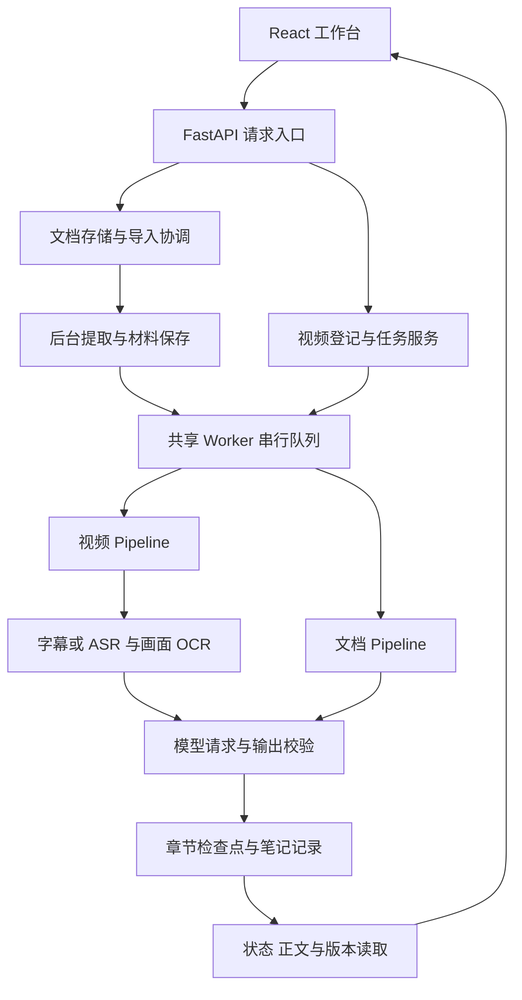

# 架构与处理流程

本页解释系统如何组织和恢复工作。操作步骤见 [安装与使用](usage.md)，具体接口与限制见 [接口与运行契约](contracts.md)，磁盘文件和恢复步骤见 [存储与恢复](storage.md)。

## 运行结构

系统以单个 FastAPI 后端进程运行，SQLite 保存记录，本地目录保存原件、识别材料和检查点。React 页面通过 HTTP 提交操作并读取状态；没有独立消息队列或浏览器端生成任务。

共享 Worker 同时只执行一个笔记任务。单个任务内部的模型请求可以并发；文档后台提取、模型文件下载、视频下载和播放副本准备有各自的执行资源。共享队列串行不代表全应用只有一个后台线程。

应用装配从 [main.py](../backend/app/main.py) 开始：先迁移和读取设置，再创建数据库、共享诊断、业务服务及 Worker，最后提供路由和前端静态页面。生命周期退出会等待工作清理，不把强制结束进程作为正常停止方式。

## 模块职责与依赖方向

| 区域 | 职责与边界 |
|---|---|
| 后端 analysis | 模型请求、预算、结构校验、Markdown 协议、章节确认、检查点和共享队列；不依赖视频或文档业务 |
| 后端 videos | 视频接入、播放、识别编排、时间分段、生成和依据读取 |
| 后端 documents | 原件与材料存储、后台导入、按来源位置分段、独立生成及任务控制 |
| 后端 recognition | 本地识别器、型号目录、模型文件准备及识别缓存身份 |
| 后端 settings | 当前设置读取、候选配置、保存发布、执行快照与私人配置迁移 |
| 后端 video_download | 链接规范化、平台元信息、字幕、登录、下载及子进程控制 |
| 前端 files | 唯一文件列表读取队列、排序、上传与文件操作 |
| 前端 documents / analysis | 各自详情和提交参数；文档导入有独立协调 Hook |
| 前端 shared / notes | 任务跟踪、作用域读取、版本、正文、导航和重点等共享机制 |

文档侧的 `DocumentStore` 只负责原件、材料、路径和数据库一致性；`DocumentImports` 依赖 Store 执行后台提取；`DocumentService` 组合两者协调列表与删除。构造时显式注入依赖，不在创建后补挂导入模块。

业务对象读取当前设置的函数由 `CurrentSettings` 提供。`SettingsService` 在写锁内按“读取最新值 → 计算候选 → 保存成功 → 发布”更新快照；其他模块不靠设置服务回写内部字段来接收变化。共享 `Diagnostics` 由入口创建，凭据脱敏读取当前设置。

## 领域数据如何区分

| 数据 | 作用 |
|---|---|
| Video / Document | 一份资料的原件与元信息；文档另区分待提取原件和正式材料 |
| Task / DocumentTask | 一次生成的执行快照、状态与结果；继续和重试仍是原任务，重新生成另建任务 |
| Evidence | 视频语音或画面原始依据，具有稳定编号和真实时间位置 |
| DocumentUnit | 文档提取材料块，保存页码、正文块、幻灯片或行范围等来源 |
| Segment | 控制请求规模的逻辑片段，不是另存的媒体文件 |
| Chapter | 根据材料规划的知识章节；Markdown 为唯一正文 |
| NoteMark | 绑定具体笔记版本的重点目标，不复制正文或修改生成配置 |

视频生成可能为请求分配短来源别名；文档生成会把材料块切为带字符偏移的片段。发送副本中的编号不能脱离映射被当作原件位置。时间、来源范围和原始材料仍由程序核对。

## 视频处理链

视频服务先分块保存上传、计算原件哈希并检查媒体容器和轨道，再登记资料。标题可编辑，实际存储格式仍按检测到的容器确定。

任务创建固定本次执行选择并入队。Pipeline 核对生成版本后，优先复用该任务绑定的有效字幕或识别缓存；首次平台字幕不可用时记录回退原因，执行本地 ASR。画面按任务保存的采样规则提取并 OCR，每完成一帧提交证据与进度。

模型输入只使用识别文字等材料，不上传原视频或截图。重复 OCR 的压缩发生在发送副本，数据库依据与原始转录保留；数字和公式差异不会按普通文字规则随意合并。

详尽风格按时间与预算划分片段，规划章节后分配主要证据和有限前文，必要时提取事实再生成正文。简洁风格按来源字符范围规划短导览。两者各自保存可恢复记录，整段完成后发布可读内容，最后完成完整结果。

## 文档处理链

网页上传使用延后提取模式，先保存原件和待处理记录。用户确认后，后台导入保存解析方式、OCR 和模型执行快照，并预分配笔记任务编号。

本地提取按格式读取材料；PDF 云端方式并行处理 MinerU 批次和本地图片 OCR，再按可验证来源合并。图片 OCR 警告不进入正文；图表数据无法可靠读取时不生成空表。

PDF 通过共用的 [适配模块](../backend/app/documents/pdf.py) 读取，固定使用 `pypdfium2==5.14.0` 与 `pypdf[crypto]==6.21.3`。PDFium 逐字符读取 Unicode、字体、位置和透明度，保留 Symbol／SymbolMT 修正、页外文字，以及仅过滤与实际绘制图片重合的完全透明异常私用字符的规则。简单阅读顺序按行恢复，不增加分栏或复杂排版推断。

pypdf 校验页数、加密和内容流，按绘制顺序遍历图片、内联图片及嵌套 Form，不读取未绘制图片资源。图片结合 pypdf、PDFium 和 Pillow 解码，原图、蒙版和合成目标在像素解码前检查尺寸；不同尺寸蒙版保留两者所需的较大分辨率。图片逐张交给共用 OCR 缓存，失败对象不重复尝试，单图失败保留其他正文和图片。PDFium 的调用与资源释放共用可取消等待的全局锁，OCR 和网络等待在锁外执行，业务层不持有原生句柄。

MinerU 批次由 pypdf 写出，继续同时限制页数和字节数，过大时缩小批次，单页仍过大则报错；批次文件使用临时文件替换保存。加密依赖仅用于可靠识别并拒绝加密 PDF，不提供解密入口。PDFium 的线程限制见 [官方说明](https://pypdfium2.readthedocs.io/en/stable/python_api.html#incompatibility-with-threading)。

Store 保存材料并执行去重。最终资料编号可能因去重而变化；导入状态记录源编号、材料编号与预分配任务编号之间的关系。重启后可在“材料已保存、映射尚未写完”或“笔记已提交、导入状态尚未完成”的交接窗口找回既有结果，避免重复解析和创建任务。

文档生成按材料顺序与字符偏移划分片段，并检查来源快照未改变。详情可先展示保存的材料，再接管随后就绪的笔记任务；已有材料重新生成不会再次提取原件。

## 请求、校验与逐章保存

[共用模型客户端](../backend/app/analysis/llm.py) 处理发送间隔、请求重试、流式响应、用量及结构修正。视频与文档客户端分别拼装请求，不共用一套庞大的领域 Pipeline。

JSON 阶段使用普通校验函数。章节阶段必须提供明确的 `ChapterCallbacks`，包括整批校验、单章校验与异步保存确认。客户端等保存确认后才修正缺失章节或返回整批结果。

视频调度循环接收单章保存请求，写盘后完成确认 Future；文档实现通过协程完成写盘。部分章节成功后其检查点可用于恢复，不能因为同批其他章节无效而丢弃。停止信号会传播到等待中的模型请求，并收集边界上已经成功的结果。

## 状态、事务与恢复

数据库是任务状态的真源，内存队列不是持久化消息系统。恢复与重试更新入队时间并排到队尾；启动恢复按该时间重建视频和文档的共同顺序。运行中的笔记任务重启后标为中断，停止中的任务转为暂停。

文件删除、任务创建和关键状态转换共用短操作锁。文档删除先改名暂存目录，数据库提交失败可移回；提交后清理失败以警告报告，不能假装数据库删除也失败。

成功结果、版本保留和待清理标志在成功事务内提交，再由共用 `CheckpointCleanup` 清理任务检查点。文件删除或标志移除失败均可重试，补清不改完成时间或版本顺序。

## 前端如何避免状态倒退

- `useTaskTracking` 先记录已接受回执，再读取完整任务。读取失败只重连，不重复发送写请求；任务切换、操作和卸载使旧结果失效。
- `useFiles` 统一串行读取文件列表。写操作后的显式刷新隔离旧响应，普通轮询只排队；详情任务快照单向同步到列表。
- 文档导入 Hook 负责提取跟踪和身份交接；历史完成提取不能覆盖后来手动创建的笔记任务。
- `useScopedRead` 管理正文、版本与依据的读取生命周期。同一身份刷新保留旧数据，切换身份取消旧请求；版本淘汰只依据本轮成功确认。
- 当前生成任务和所选阅读版本分别维护。Markdown、公式和代码资源按需加载，笔记中心只呈现纯文本摘要。
- 请求错误的上报与通知策略、B 站会话的发布订阅均有明确接口；展示组件不承担业务日志上报。

阅读代码与选择验证路径可从 [开发与测试](development.md) 继续。
